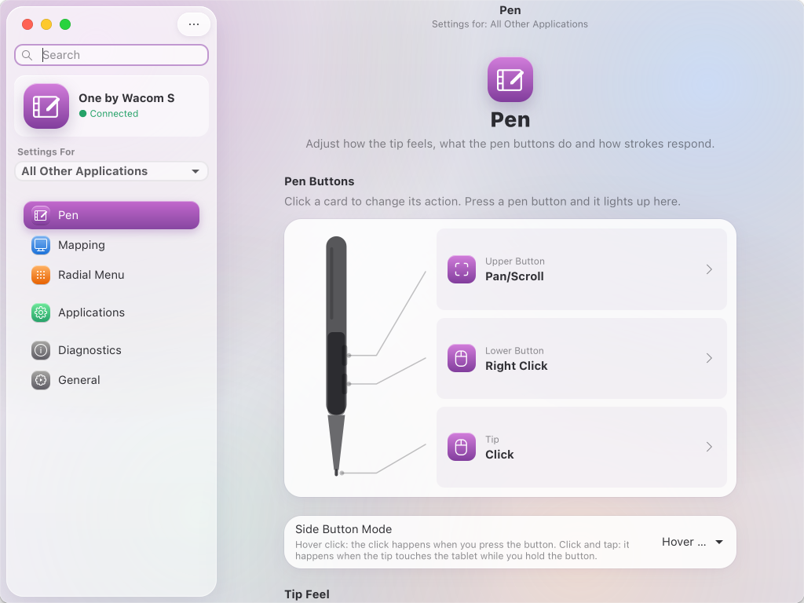

# Trazo

**Your Wacom tablet, finally at home on Linux.**

Complete Wacom tablet settings for Linux, with the same features as Wacom Center on
Windows and macOS. Tested with the **One by Wacom S (CTL-472)** on Ubuntu 26.04 with
GNOME 50 (Wayland).

**Website:** https://jdswe.github.io/trazo/ ·
**Download:** [latest release](https://github.com/jdswe/trazo/releases/latest)



## Features

**Pen**
- Tip feel: soft ↔ firm, click threshold, maximum pressure and a custom curve you edit
  by dragging, with a live test area.
- Tip-up assist (keeps strokes from breaking).
- Smoothing and double-click distance.
- Any action on the side buttons and the tip: click, right and middle click, double
  click, click lock, back/forward, keystroke, modifier, undo/redo, copy/paste, zoom,
  pan/scroll, scroll, precision mode, pressure hold, pen/mouse mode toggle, display
  toggle, radial menu, switch application, show desktop, activities overview, open an
  app or command, or disabled.
- "Hover click" or "click & tap" side button mode.

**Mapping**
- Orientation: landscape, left-handed (180°) and portrait (90°/270°).
- Pen mode (absolute) or mouse mode (relative, with speed and acceleration).
- Screen area: all displays, one display or a portion (by dragging or "define with the
  pen").
- Tablet area: whole tablet or a portion, and force proportions.

**Just like Windows and macOS**
- The pen is also the mouse: one cursor, and the dock, hot corners and GNOME menus react
  when the pen hovers over them.
- Touch mode (like Windows Ink): tap = click, drag = scroll with momentum, press and
  hold = right click. Recommended for web browsers.
- Tap ripples, a precision mode overlay and stroke smoothing.
- Radial menu (like Wacom's on-screen shortcuts) with 8 actions.

**Applications**: one profile per application, switched automatically when that app
comes to the front.

**Diagnostics**: live pen data (pressure, position, buttons, report rate).

**General**: Setup Assistant, backup (export/import), reset and advanced settings.

The interface follows the macOS style (Liquid Glass) on top of the system theme
(Macify / WhiteSur).

## How it works

Like the official driver, Trazo has three parts:

| Part | Wacom (Windows/macOS) | Trazo |
|---|---|---|
| Hardware access | `wachidrouter.sys` / `Wacom_IOManager` | kernel `wacom` driver + udev rule |
| Service that applies the settings | `WTabletServicePro` / `WacomTabletDriver` | `trazo-daemon` |
| Settings app | Wacom Center | `trazo` (GTK 4 + libadwaita) |

`trazo-daemon` takes **exclusive** control of the pen (GNOME no longer receives it
directly), applies the curve, area, buttons and active profile, and sends the result to
GNOME through a virtual pen, mouse and keyboard (`uinput`). While it runs, it also keeps
GNOME's tablet settings neutral so they are not applied on top, and restores them when
it stops.

The **Trazo** GNOME Shell extension reports the focused application (to switch
profiles), keeps a single visible cursor and draws the ripples, the precision overlay
and the radial menu.

## Install

**Ubuntu and Debian:** download `trazo_VERSION_all.deb` from the
[latest release](https://github.com/jdswe/trazo/releases/latest) and run, from the folder
where you saved it:

```bash
sudo apt install ./trazo_0.1.0_all.deb
```

**Any other distribution (per-user install):** download `trazo-VERSION.tar.gz`, extract it
and run the installer as your normal user. It asks for your password once to install the
permission rule (`/etc/udev/rules.d/70-trazo.rules`).

```bash
tar xf trazo-0.1.0.tar.gz && cd trazo-0.1.0 && ./install.sh
```

Either way, log out and back in once to turn on the service and the GNOME extension.
Requirements: GNOME 45 or newer, Python 3.10+, GTK 4 and libadwaita.

## Uninstall

- Package: `sudo apt remove trazo`
- Per-user install: `./uninstall.sh` from the extracted folder

## Build the release files

```bash
packaging/build.sh   # creates dist/trazo_VERSION_all.deb, dist/trazo-VERSION.tar.gz and SHA256SUMS
```

## Security

The udev rule gives the user of the active session access to the tablet and to `uinput`
(creating virtual input devices). OpenTabletDriver needs the same access. Any program
you run as your user could use that access.

## Trademarks

Trazo is an independent open source project and is not affiliated with or endorsed by
Wacom. Wacom is a trademark of Wacom Co., Ltd.

## Troubleshooting

- Service log: `journalctl --user -u trazo-daemon -f`
- Restart the service: `systemctl --user restart trazo-daemon`
- Turn off the GNOME extension: `gnome-extensions disable trazo@jdswe.github.io`
- Tests: `python3 -m unittest discover -s tests -t .`
